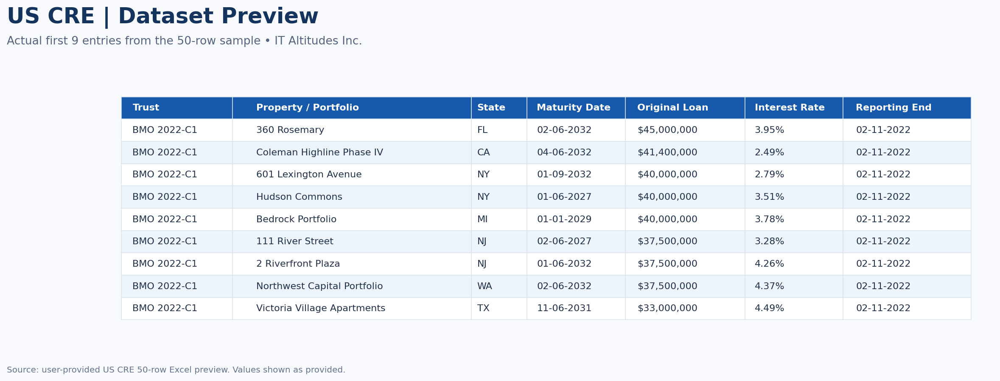
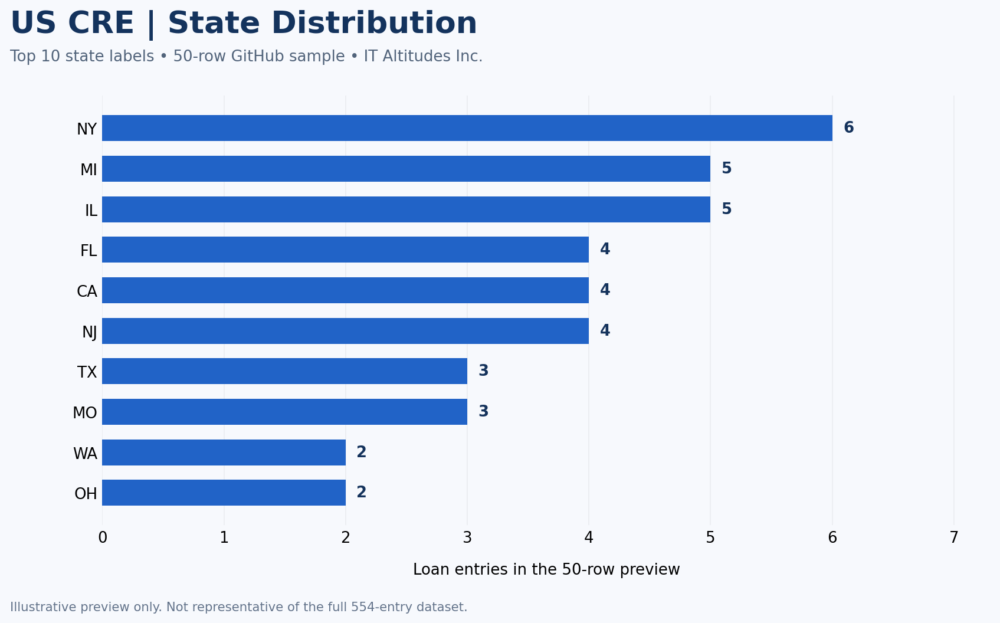

# US CRE Loan Maturity & Risk Reference Dataset

### 🛒 Get the Complete Dataset

**[Purchase the Full Dataset on Gumroad](https://italtitudes.gumroad.com/l/cyvqx)**

**Price: $189 | Full Buyer Kit Available in Excel & CSV Editions**

**Free 50-Row Preview: Excel (.xlsx) | CSV (.csv) | JSON (.json)**

---

## About the Dataset

The **US CRE Loan Maturity & Risk Reference Dataset**, prepared by **IT Altitudes Inc.**, provides structured U.S. commercial real estate loan information curated from publicly available SEC EDGAR filings.

The dataset is designed to simplify CRE loan research, maturity analysis, credit risk assessment, and portfolio research.

## 📊 Dataset Overview

| Feature | Details |
|---|---|
| Dataset | US CRE Loan Maturity & Risk Reference |
| Publisher | IT Altitudes Inc. |
| Coverage | United States |
| Source | SEC EDGAR filings |
| Full Dataset | 554 curated loan entries |
| Free Preview | 50 sample records |
| Preview Formats | Excel, CSV, JSON |
| Excel Edition | Complete buyer kit with documentation |
| CSV Edition | Primary loan records |
| Price | $189 |
| Data Type | Static reference snapshot |

## 📂 Free 50-Row Buyer Preview — Excel, CSV & JSON

Explore the dataset before purchasing. The repository provides **50 selected loan records** in multiple formats for evaluation, research, and technical testing.

### Download Preview Files

| Format | Recommended Use | Download |
|---|---|---|
| Excel (.xlsx) | Spreadsheet exploration and sample review | [View Excel Preview](https://github.com/ITAltitudesDataset/us-cre-loan-maturity-risk-dataset-preview) |
| CSV (.csv) | Python, R, SQL, Power BI, and analytical workflows | [View CSV Preview](https://github.com/ITAltitudesDataset/us-cre-loan-maturity-risk-dataset-preview) |
| JSON (.json) | Application development, structured data processing, and integration testing | [Download JSON Preview](US_CRE_50_Row_Buyer_Preview.json) |

### Preview Details

- **Sample Size:** 50 loan records
- **Columns:** 7 in the CSV and JSON preview
- **Geographic Coverage:** United States
- **Source:** Public SEC EDGAR filing information
- **Available Formats:** Excel, CSV, JSON

The CSV and JSON previews contain the same 50 sample records and column names.

The Excel preview may also include supporting documentation.

**Why Multiple Formats?**

- **Excel:** Convenient for spreadsheet review and exploration.
- **CSV:** Suitable for data analysis, imports, and ETL workflows.
- **JSON:** Useful for developers, application prototyping, and integration testing.

*The preview contains selected loan information and is intended for evaluation purposes. It does not represent the complete dataset.*

---

## ✨ Why Choose This Dataset?

- **Save research time:** Structured information compiled from public SEC filings.
- **Loan maturity insights:** Explore reported maturity dates, loan amounts, and interest rates.
- **CRE risk research:** Support analysis of available loan-level indicators.
- **Organized data:** Consistent tabular structure for filtering and analysis.
- **Flexible formats:** Excel and CSV paid editions, plus Excel, CSV, and JSON free previews.
- **Buyer-friendly documentation:** The Excel buyer kit includes field definitions, methodology, and source information.

## 🎯 Ideal For

- Commercial real estate analysts
- Credit risk and lending professionals
- Portfolio managers and financial researchers
- Real estate consultants
- Academic and market researchers
- Data analysts working with CRE information
- Software developers evaluating structured CRE data

## 💼 Business Use Cases

The **US CRE Loan Maturity & Risk Reference Dataset** supports research and analytical applications across commercial real estate finance, lending, portfolio analysis, market intelligence, and data engineering.

The following use cases illustrate how organizations can work with structured SEC EDGAR-derived commercial real estate loan information for historical research, exploratory analysis, and non-production analytical workflows.

### 1. Commercial Real Estate Loan Maturity Analysis

**Ideal for:** CRE analysts, commercial lenders, real estate consultants, and financial researchers.

**Business Applications:**

- Examine reported loan maturity dates across available records.
- Group loans by maturity year to study potential refinancing periods.
- Analyze available loan amounts and interest rate information.
- Prepare exploratory loan maturity schedules.
- Develop historical maturity distribution reports.

**Potential Buyer Value:** Reduce manual organization of SEC filing information and support structured commercial real estate loan maturity research.

### 2. CRE Credit Risk & Exposure Research

**Ideal for:** Credit risk researchers, lending analysts, and financial institutions.

**Business Applications:**

- Explore reported loan-level characteristics relevant to credit risk research.
- Compare available loan amounts, maturity dates, and interest rates.
- Study concentration patterns across the available records.
- Identify records requiring further investigation using authoritative source documents.
- Develop exploratory credit exposure summaries.

**Potential Buyer Value:** Support preliminary credit risk research using structured loan reference information.

**Important:** The dataset does not provide independently validated credit ratings, default probabilities, or complete borrower-level financial assessments.

### 3. Commercial Mortgage Refinancing Research

**Ideal for:** Commercial mortgage researchers, real estate finance consultants, and investment analysts.

**Business Applications:**

- Identify historical loan records grouped by reported maturity periods.
- Examine loan characteristics potentially relevant to refinancing research.
- Compare available loan balances and interest rate information.
- Prepare descriptive reports on selected commercial mortgage exposures.
- Support preliminary research into commercial real estate refinancing trends.

**Potential Buyer Value:** Provide structured reference information for historical refinancing-related analysis.

**Important:** Reported maturity dates and balances may have changed since the underlying filings. They must not be treated as current outstanding obligations without independent verification.

### 4. CRE Portfolio & Market Intelligence

**Ideal for:** Portfolio research teams, CRE consultants, and institutional market researchers.

**Business Applications:**

- Examine available loan records across the dataset.
- Analyze selected loan characteristics for exploratory portfolio research.
- Review linked property information in the Excel buyer kit.
- Prepare descriptive summaries of loan and property relationships.
- Support market research reports and internal analytical presentations.

**Potential Buyer Value:** Reduce manual preparation of selected SEC-derived CRE loan and property reference information.

**Important:** Records may represent reported loan interests rather than unique whole mortgages. They should not automatically be aggregated as distinct underlying loans.

### 5. Commercial Real Estate Investment Research

**Ideal for:** Real estate investment researchers, financial analysts, and consulting firms.

**Business Applications:**

- Study historical commercial mortgage characteristics.
- Examine selected loan maturity and interest rate information.
- Compare available records for exploratory financial research.
- Prepare supporting reference tables for investment research reports.
- Identify areas requiring additional source-document review.

**Potential Buyer Value:** Support preliminary commercial real estate investment research with organized reference data.

**Important:** The dataset does not establish current investment value, property performance, borrower creditworthiness, or investment suitability.

### 6. Business Intelligence & CRE Analytics Dashboards

**Ideal for:** Business intelligence analysts, financial data analysts, and dashboard developers.

**Business Applications:**

- Create loan maturity distribution charts.
- Visualize available loan amounts and interest rate information.
- Develop exploratory dashboards using Excel, Power BI, Tableau, or Python.
- Prepare summaries based on available loan-level fields.
- Build research dashboards for non-production analytical workflows.

**Potential Buyer Value:** Simplify data preparation for commercial real estate loan research dashboards and visual reporting.

### 7. Financial Data Engineering & ETL Development

**Ideal for:** Data engineers, software developers, and financial analytics teams.

**Business Applications:**

- Import structured CRE loan records into SQL databases.
- Develop CSV ingestion and transformation pipelines.
- Test JSON parsing using the free preview.
- Practice schema validation and missing-value handling.
- Build analytical prototypes using financial reference information.
- Evaluate data processing workflows with structured loan records.

**Potential Buyer Value:** Provide a practical reference dataset for financial data engineering, software testing, and analytical prototyping.

### 8. Academic & Commercial Real Estate Finance Research

**Ideal for:** Universities, students, economists, and academic research institutions.

## Machine Learning Demonstration

Explore our reproducible US CRE Loan Maturity & Risk ML demonstration using the 50-row preview.

The Isolation Forest model analyzes loan amounts, interest rates, and maturity periods, identifying 5 statistically unusual observations.

**[View US CRE ML Demonstration](ml_demo/README_ML_DEMO.md)**

*Educational demonstration only. Anomaly flags do not establish credit risk, default probability, or investment suitability.*

**Business Applications:**

- Study historical commercial mortgage characteristics.
- Analyze reported maturity dates and interest rate information.
- Develop educational exercises involving financial reference data.
- Practice exploratory financial data analysis.
- Prepare academic reports and visualizations using publicly sourced records.

**Potential Buyer Value:** Provide organized reference information for educational research and financial data analysis.

## Dataset Preview & Visual Insights

### Sample Loan Records

### Geographic Distribution — 50-Row Sample

Explore the free 50-row preview to examine commercial real estate loan information, including property names, states, maturity dates, original loan amounts, interest rates, and reporting periods.

**Note:** The visualizations represent the 50-row sample only, not the complete 554-entry dataset.

**[Get the Complete US CRE Loan Maturity & Risk Dataset](https://italtitudes.gumroad.com/l/cyvqx)**

For source information and quality limitations, see our [Data Quality Report](DATA_QUALITY_REPORT.md).

### Why Consider the Complete Buyer Kit?

The free 50-row preview allows users to evaluate the dataset structure and selected loan records.

The complete buyer kit offers:

- **554 curated loan entries** for broader historical analysis.
- **Structured loan reference information** prepared from SEC EDGAR filings.
- **Excel Buyer Kit:** Includes linked property records and supporting documentation.
- **CSV Edition:** Provides the primary loan records for lightweight analytical workflows.
- **Research Documentation:** Includes methodology, source provenance, and usage limitations in the Excel edition.
- **Analytical Compatibility:** Suitable for Excel, Python, R, SQL, and business intelligence workflows.

**[Explore the Complete US CRE Loan Maturity & Risk Dataset — $189](https://italtitudes.gumroad.com/l/cyvqx)**

*Business use cases are illustrative and depend on the available fields, completeness, and historical coverage of the purchased dataset. This is a static reference resource, not a live credit risk scoring system, loan servicing database, or investment advisory product.*

---

## 📦 What's Included in the Paid Editions?

### Excel – Complete Buyer Kit

- 554 curated loan entries
- Linked property records
- Data dictionary
- Methodology and source provenance
- Buyer instructions and use cases
- Limitations and licensing information

### CSV – Primary Loan Records

- 554 curated loan entries
- Lightweight CSV file
- Easy import and export
- Compatible with Excel, Google Sheets, Python, R, and SQL workflows

*The CSV edition contains the primary loan table only; the linked-property tables and expanded documentation are included in the Excel edition.*

**Note:** JSON is provided for the free 50-row preview. The complete paid dataset is offered in Excel and CSV editions.

---

## 🔍 Data Preparation & Source Validation

IT Altitudes Inc. structured the dataset using publicly available SEC EDGAR filing information.

Preparation included source comparison, field standardization, duplicate and relevance review, and organization of loan and property information.

**Important:** Records represent source-reported loan interests and should not automatically be interpreted as distinct underlying whole mortgages.

## ⚖️ Source & Usage Disclaimer

Independently curated by IT Altitudes Inc. from public SEC EDGAR filings. Not affiliated with or endorsed by the SEC.

Original source rights remain with their respective owners.

The dataset is provided as-is for research and analytical purposes, without financial, legal, or investment advice.

Commercial use and redistribution are subject to applicable rights and license terms. Purchasing the dataset does not grant resale, redistribution, or sublicensing rights.

## 🛒 Purchase the Full Dataset

The free preview demonstrates the dataset's structure and sample records. The complete buyer kit provides **554 curated loan entries**, with additional documentation available in the Excel edition.

**[Get the US CRE Loan Maturity & Risk Reference Dataset — $189](https://italtitudes.gumroad.com/l/cyvqx)**

Available in Excel and CSV editions.

---

**Prepared by IT Altitudes Inc.**

*Structured Data | Research-Ready Reference | Buyer-Friendly Documentation*

---

## License & Liability Documentation

- [Preview License & Usage Terms](LICENSE.md)
- [SEC Source Attribution & Liability Disclaimer](DISCLAIMER.md)

This dataset is a static reference snapshot prepared from publicly available SEC EDGAR filing information.

It is intended for research and analytical use, not live credit decisions or investment recommendations.

Underlying source materials and IT Altitudes' original value-added documentation remain subject to their respective applicable rights.

## Explore More Datasets from IT Altitudes Inc.

- [OFAC Sanctions (SDN) Dataset](https://github.com/ITAltitudesDataset/ofac-sanctions-dataset-sample)
- [US Area Codes & Geographic Reference](https://github.com/ITAltitudesDataset/us-area-codes-dataset-preview)
- [Global Tariff Realignment](https://github.com/ITAltitudesDataset/Global-Tariff-Realignment-Dataset-Preview)
- [Geothermal Electricity Capacity](https://github.com/ITAltitudesDataset/geothermal-electricity-capacity-dataset)

**[Explore Our Complete Dataset Catalog](https://github.com/ITAltitudesDataset)**
