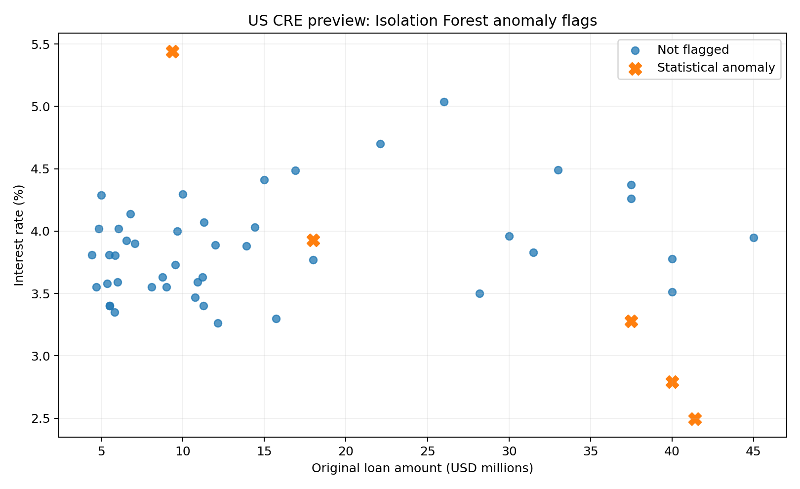

# US CRE Loan Maturity & Risk — ML Demonstration

**IT Altitudes Inc.** | Educational, reproducible demonstration on the free 50-row preview.

## What it does
An Isolation Forest model flags unusual combinations of **original loan amount, interest rate, and time to maturity**. Loan amount is log-transformed and features are standardized. The model uses `contamination=0.10`, so roughly 10% of observations are expected to be flagged.

## Results
- Preview records analyzed: **50**
- Statistical anomalies flagged: **5**
- Original preview columns: **7**
- Source shown in preview: **BMO 2022-C1** (all 50 rows)

## Reproduce
1. Install Python 3.10+ and `pip install pandas numpy scikit-learn matplotlib`.
2. Run `python run_us_cre_ml_demo.py` from this folder.
3. Inspect `us_cre_ml_results.csv` and `us_cre_ml_chart.png`.

## Files
- `us_cre_preview_50.csv` — source preview exported from the supplied workbook
- `run_us_cre_ml_demo.py` — reproducible model script
- `us_cre_ml_results.csv` — per-record output
- `us_cre_ml_chart.png` — visualization

## Important limitations
- The 50 records are **not a representative random sample** of the 554-entry full dataset; all are from one trust.
- Statistical outliers are **not** confirmed bad data, risky loans, expected defaults, or investment recommendations.
- No supervised target labels or validated credit-risk accuracy are available.
- The date format is interpreted as **DD-MM-YYYY**; confirm against the original SEC filing before relying on maturity calculations.
- Research/demo only; not financial advice.

[Free GitHub preview](https://github.com/ITAltitudesDataset/us-cre-loan-maturity-risk-dataset-preview) | [Complete dataset information](https://italtitudes.gumroad.com/l/cyvqx)
